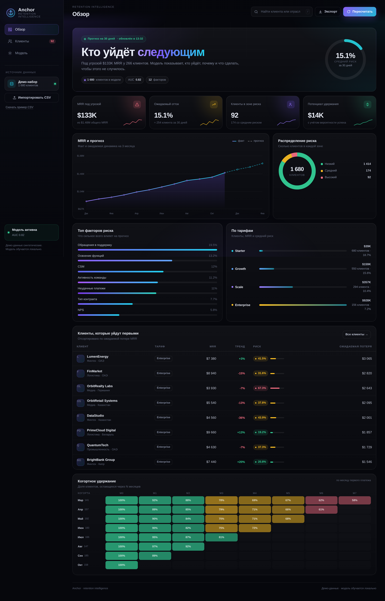
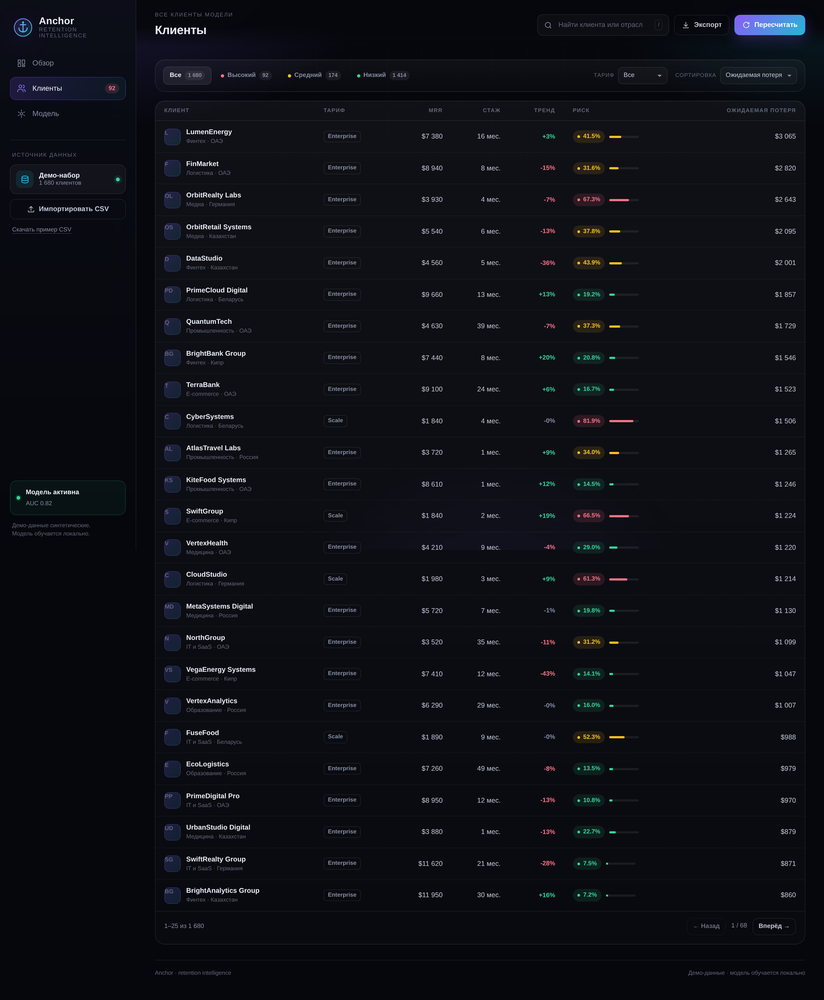
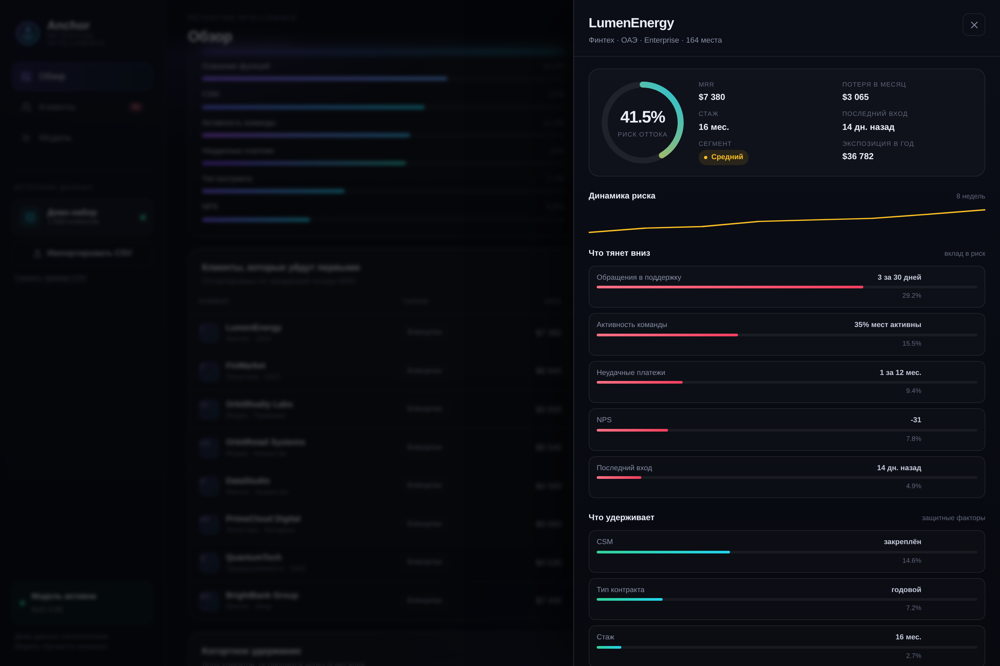
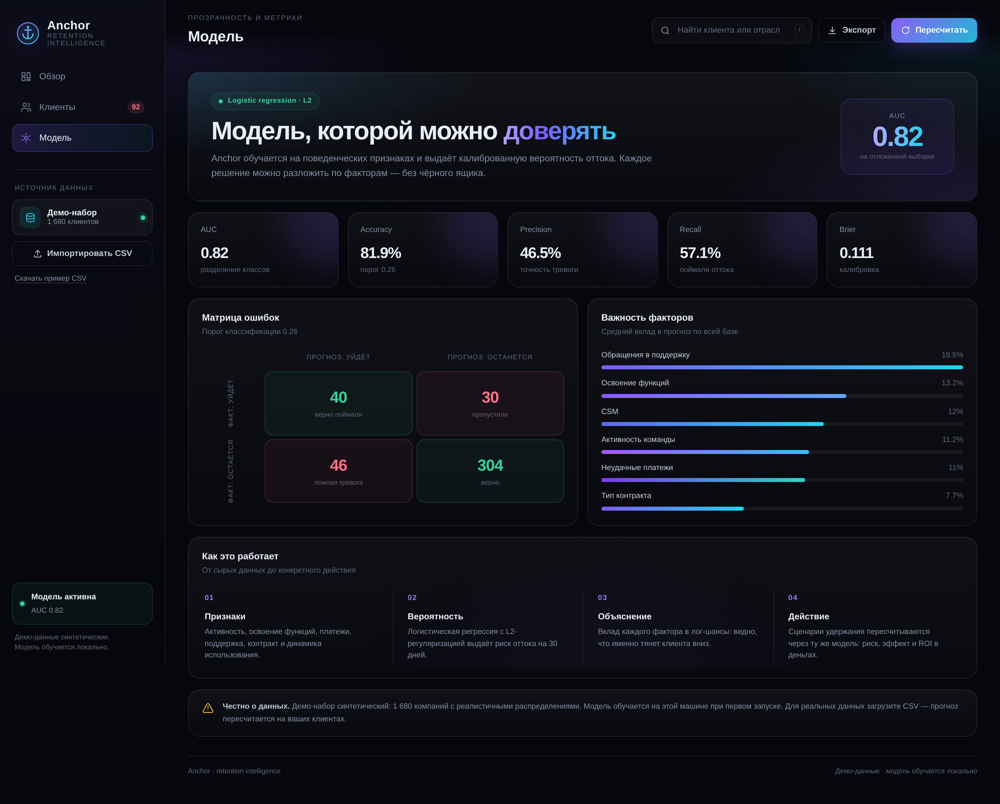
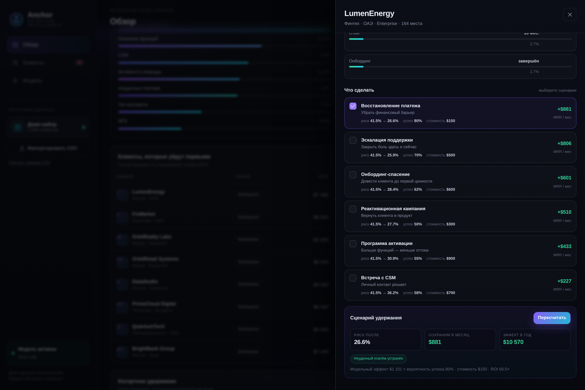

# ⚓ Anchor

**Retention intelligence для подписочного бизнеса.**

Anchor показывает, кто уйдёт в следующие 30 дней, сколько MRR под угрозой, почему каждый клиент рискует — и что конкретно сделать, чтобы его удержать.

> **EN:** Anchor is a retention intelligence dashboard. It predicts 30-day customer churn, explains the drivers behind every score, quantifies revenue at risk, and simulates retention playbooks with expected ROI.



---

## Проблема

Подписочный бизнес теряет клиентов каждый месяц. Отток замечают постфактум — когда клиент уже отписался, а деньги ушли из MRR. При этом почти всегда в данных заранее есть сигналы: упавшая активность, нерешённые тикеты, неудачный платёж, слабое освоение продукта.

Anchor превращает эти сигналы в конкретный список действий и деньги.

## Что делает продукт

- **Прогнозирует отток** для каждого клиента на 30 дней вперёд.
- **Показывает MRR под угрозой** и ожидаемую потерю по каждому аккаунту.
- **Объясняет риск**: какие факторы тянут клиента вниз, а какие удерживают.
- **Считает сценарии удержания**: онбординг, активация, поддержка, платёж, годовой контракт, CSM, реактивация.
- **Симулирует эффект**: риск до/после, сохранённый MRR, годовой эффект, стоимость и ROI.
- **Работает с вашими данными**: загрузка CSV, пересчёт прогноза на вашей базе.

## Демо

```bash
python3 -m venv .venv
source .venv/bin/activate
pip install -r requirements.txt
uvicorn app.main:app --reload
```

Откройте [http://127.0.0.1:8000](http://127.0.0.1:8000).

При первом запуске Anchor генерирует демо-базу из 1 680 клиентов и обучает модель локально. Никакие данные наружу не уходят.

Запуск в Docker:

```bash
docker build -t anchor .
docker run --rm -p 8000:8000 anchor
```

## Скриншоты

| Клиенты и риск | Профиль клиента и сценарии |
|---|---|
|  |  |

| Модель и метрики | Симулятор удержания |
|---|---|
|  |  |

## Как это устроено

```
Поведенческие признаки → логистическая регрессия → вероятность оттока
        ↓                        ↓                        ↓
  12 факторов            L2-регуляризация         объяснение по факторам
        ↓                        ↓                        ↓
  MRR под угрозой        сценарии удержания        ROI в деньгах
```

1. **Признаки.** Стаж, активность команды, освоение функций, интеграции, обращения в поддержку, NPS, неудачные платежи, динамика использования, давность входа, тип контракта, онбординг, CSM.
2. **Модель.** Логистическая регрессия с L2-регуляризацией, обучение через IRLS (Newton-Raphson). Стандартизация признаков, отложенная выборка 75/25.
3. **Объяснение.** Вклад каждого признака считается как `коэффициент × z-значение`. Это лог-шансы: видно, что именно повышает или понижает риск.
4. **Сценарии.** Действия меняют признаки клиента, после чего модель пересчитывает вероятность. Эффект и ROI считаются на реальной модели, а не на заранее заданных процентах.

## Метрики модели

| Метрика | Значение |
|---|---|
| AUC | **0.82** |
| Accuracy | 81.9% |
| Precision | 46.5% |
| Recall | 57.1% |
| Brier score | 0.11 |
| Признаков | 12 |
| Порог | выбран по F1 |

Метрики на отложенной выборке. Порог классификации подбирается автоматически по F1, а не фиксируется на 0.5.

## Стек

- **Python 3.11+**
- **FastAPI** — API и раздача интерфейса
- **Vanilla JS + SVG** — дашборд без сборки и внешних зависимостей
- **Чистый Python** — модель, метрики и матричная алгебра без numpy
- **pytest** — тесты модели и API

## Данные и CSV

Демо-набор синтетический: 1 680 компаний с реалистичными распределениями по тарифам, активности, платежам и поддержке. Модель обучается на нём при первом запуске.

Для загрузки своих данных используйте CSV. Обязательные колонки:

```csv
company,mrr
Acme Retail,1200
Beta Labs,300
```

Остальные колонки опциональны и подставляются разумными значениями:

`plan`, `seats`, `tenure_months`, `active_ratio`, `sessions_30d`, `feature_adoption`, `integrations`, `support_tickets_30d`, `avg_first_response_h`, `nps`, `payment_failures_12m`, `discount_pct`, `contract`, `onboarding_completed`, `csm_assigned`, `usage_trend_30d`, `last_login_days`.

Пример: [http://127.0.0.1:8000/api/sample.csv](http://127.0.0.1:8000/api/sample.csv).

## API

| Метод | Путь | Назначение |
|---|---|---|
| `GET` | `/api/health` | Статус и метрика модели |
| `GET` | `/api/overview` | KPI, графики, топ клиентов, когорты |
| `GET` | `/api/customers` | Список с фильтрами и пагинацией |
| `GET` | `/api/customers/{id}` | Профиль, факторы риска, сценарии |
| `POST` | `/api/simulate` | Пересчёт выбранных действий |
| `POST` | `/api/upload` | Импорт CSV |
| `POST` | `/api/reset` | Возврат к демо-данным |
| `GET` | `/api/sample.csv` | Пример файла |

Документация FastAPI доступна на `/docs`.

## Структура

```
anchor/
├── app/
│   ├── analytics.py   # KPI, фильтры, сценарии, импорт
│   ├── data.py        # генерация демо-базы и когорт
│   ├── features.py    # признаки и их описание
│   ├── main.py        # FastAPI, API, CSV
│   ├── model.py       # IRLS, метрики, объяснение
│   └── playbooks.py   # сценарии удержания
├── static/
│   ├── app.js         # SPA без сборки
│   ├── index.html
│   └── styles.css
├── tests/
│   ├── test_api.py
│   └── test_model.py
├── .github/workflows/tests.yml
├── Dockerfile
├── requirements.txt
├── requirements-dev.txt
└── README.md
```

## Тесты

```bash
pip install -r requirements-dev.txt
pytest -q
```

Проверяются качество модели, диапазон вероятностей, контракт API, фильтры, импорт CSV, симулятор и возврат к демо-данным.

## Бизнес-модель

SaaS-подписка по размеру клиентской базы: от небольших команд до компаний с базой в десятки тысяч аккаунтов. Точки расширения — интеграции с billing/CRM (Stripe, HubSpot, amoCRM), автоматические сценарии удержания и командная работа.

Экономика простая и проверяемая на демо: один спасённый клиент с MRR $500 при риске 40% возвращает ~$200 ожидаемого MRR в месяц и ~$2 400 в год — больше, чем годовая стоимость типичного тарифа для небольшой команды. Anchor показывает этот расчёт по каждому аккаунту, поэтому ценность продукта видна в те же деньги, что и его цена.

## Дорожная карта

- Интеграции с Stripe, HubSpot, amoCRM и продуктовой аналитикой.
- SHAP-объяснения и контроль drift модели.
- Survival-модели и прогноз LTV вместо одной точки оттока.
- Автоматические плейбуки: задача в CRM, письмо, скидка.
- Мультиарендность и роли.

## Ограничения

- Демо-данные синтетические — это продукт для проверки гипотезы, а не обученная на реальном рынке модель.
- Логистическая регрессия — интерпретируемый baseline; сложные нелинейные зависимости она не ловит.
- Метрики зависят от качества загруженных данных и определения «оттока».

---

Сделано как демонстрация продукта: настоящая модель, настоящие расчёты, интерфейс без заглушек.
